# ambientCG: Rock materials

**22 assets from [ambientCG](https://ambientcg.com), dedicated to the public domain under [CC0](https://docs.ambientcg.com/license/).** Use them in any game, free or paid, and change them however you like; no credit is needed.

PBR materials as 1K and 2K JPG maps (colour, normal GL and DX, roughness, AO, displacement), one folder per resolution. 866.4 MB in all.

This is a copy kept by [zuujis-cc0](https://github.com/zuujis-cc0) so game makers can take single files from GitHub. It is not made by or affiliated with ambientCG: the originals, often in more formats and higher resolutions, are on [ambientcg.com](https://ambientcg.com). If they help you, consider [supporting ambientCG](https://www.patreon.com/ambientCG).

Every file is listed in [MANIFEST.tsv](MANIFEST.tsv) with its size and SHA-256. More free assets: [the Zuujis collection](https://github.com/zuujis-cc0/free-game-assets#readme).

| | | | |
| :-: | :-: | :-: | :-: |
| <a href="Rock027">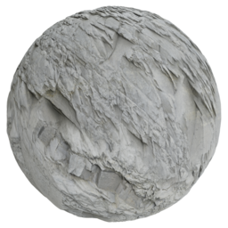</a> <b><a href="Rock027">Rock 027</a></b> by ambientCG · <a href="https://ambientcg.com/a/Rock027">source</a> | <a href="Rock028">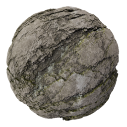</a> <b><a href="Rock028">Rock 028</a></b> by ambientCG · <a href="https://ambientcg.com/a/Rock028">source</a> | <a href="Rock029">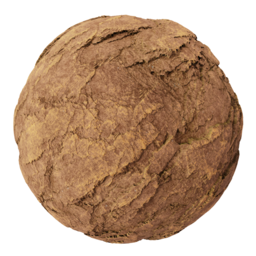</a> <b><a href="Rock029">Rock 029</a></b> by ambientCG · <a href="https://ambientcg.com/a/Rock029">source</a> | <a href="Rock030">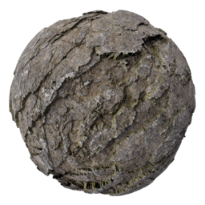</a> <b><a href="Rock030">Rock 030</a></b> by ambientCG · <a href="https://ambientcg.com/a/Rock030">source</a> |
| <a href="Rock031">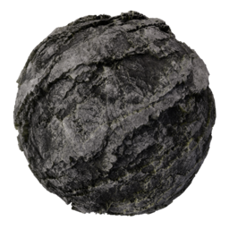</a> <b><a href="Rock031">Rock 031</a></b> by ambientCG · <a href="https://ambientcg.com/a/Rock031">source</a> | <a href="Rock032">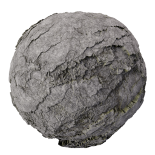</a> <b><a href="Rock032">Rock 032</a></b> by ambientCG · <a href="https://ambientcg.com/a/Rock032">source</a> | <a href="Rock033">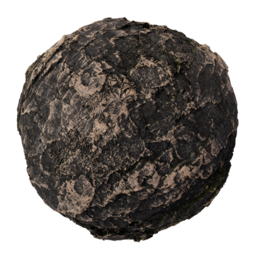</a> <b><a href="Rock033">Rock 033</a></b> by ambientCG · <a href="https://ambientcg.com/a/Rock033">source</a> | <a href="Rock034">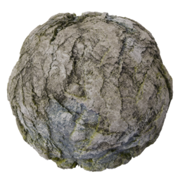</a> <b><a href="Rock034">Rock 034</a></b> by ambientCG · <a href="https://ambientcg.com/a/Rock034">source</a> |
| <a href="Rock035">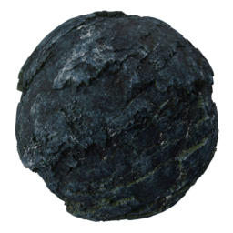</a> <b><a href="Rock035">Rock 035</a></b> by ambientCG · <a href="https://ambientcg.com/a/Rock035">source</a> | <a href="Rock036">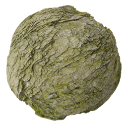</a> <b><a href="Rock036">Rock 036</a></b> by ambientCG · <a href="https://ambientcg.com/a/Rock036">source</a> | <a href="Rock037">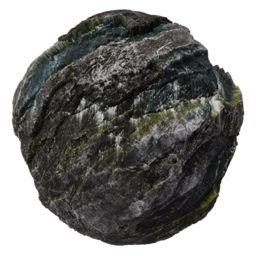</a> <b><a href="Rock037">Rock 037</a></b> by ambientCG · <a href="https://ambientcg.com/a/Rock037">source</a> | <a href="Rock038">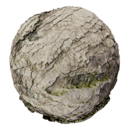</a> <b><a href="Rock038">Rock 038</a></b> by ambientCG · <a href="https://ambientcg.com/a/Rock038">source</a> |
| <a href="Rock039">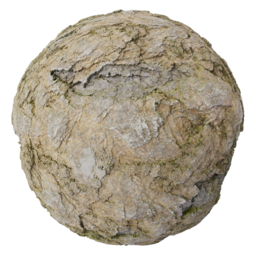</a> <b><a href="Rock039">Rock 039</a></b> by ambientCG · <a href="https://ambientcg.com/a/Rock039">source</a> | <a href="Rock040">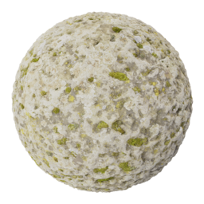</a> <b><a href="Rock040">Rock 040</a></b> by ambientCG · <a href="https://ambientcg.com/a/Rock040">source</a> | <a href="Rock041">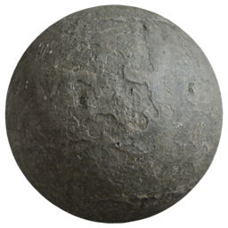</a> <b><a href="Rock041">Rock 041</a></b> by ambientCG · <a href="https://ambientcg.com/a/Rock041">source</a> | <a href="Rock042L">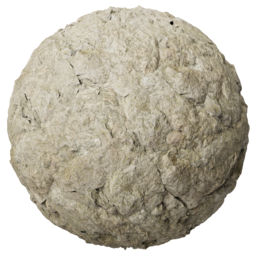</a> <b><a href="Rock042L">Rock 042 L</a></b> by ambientCG · <a href="https://ambientcg.com/a/Rock042L">source</a> |
| <a href="Rock042S">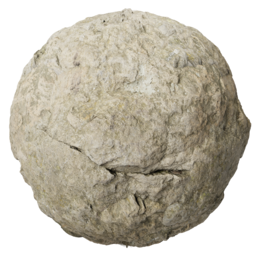</a> <b><a href="Rock042S">Rock 042 S</a></b> by ambientCG · <a href="https://ambientcg.com/a/Rock042S">source</a> | <a href="Rock043L">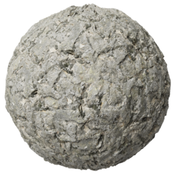</a> <b><a href="Rock043L">Rock 043 L</a></b> by ambientCG · <a href="https://ambientcg.com/a/Rock043L">source</a> | <a href="Rock043S">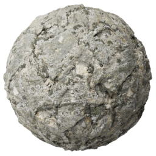</a> <b><a href="Rock043S">Rock 043 S</a></b> by ambientCG · <a href="https://ambientcg.com/a/Rock043S">source</a> | <a href="Rock044">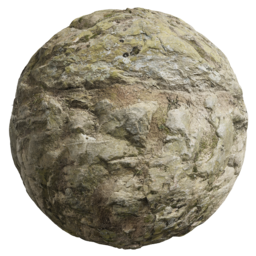</a> <b><a href="Rock044">Rock 044</a></b> by ambientCG · <a href="https://ambientcg.com/a/Rock044">source</a> |
| <a href="Rock045">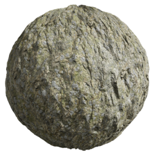</a> <b><a href="Rock045">Rock 045</a></b> by ambientCG · <a href="https://ambientcg.com/a/Rock045">source</a> | <a href="Rock046L">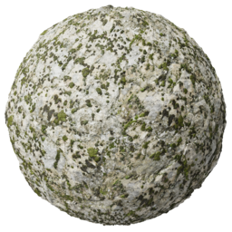</a> <b><a href="Rock046L">Rock 046 L</a></b> by ambientCG · <a href="https://ambientcg.com/a/Rock046L">source</a> |  |  |

---

Kept up to date by this repository's own [update workflow](.github/workflows/update.yml), with code and plan from [cc0-mirror](https://github.com/zuujis-cc0/cc0-mirror). Something wrong? [Open an issue there](https://github.com/zuujis-cc0/cc0-mirror/issues/new) or use the [private report form](https://games.zuujis.com/report).
